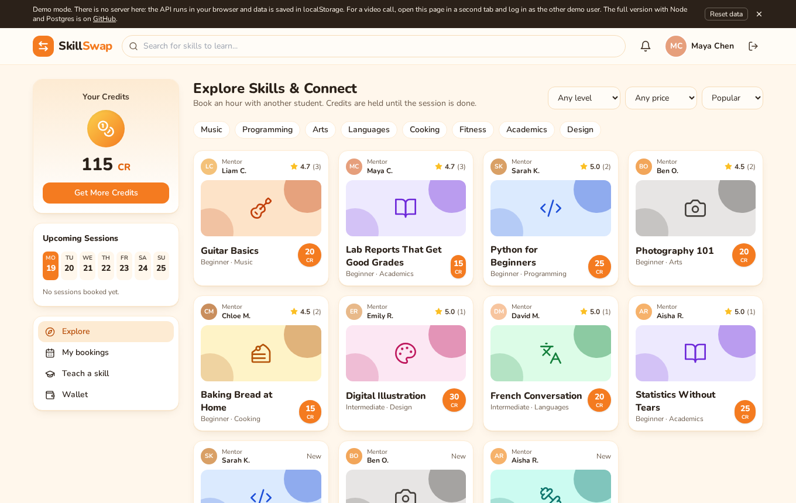

# SkillSwap

A marketplace where students teach each other and pay in credits instead of money. I built it to try out the part that is more than CRUD: a two-sided credit economy with escrow, refunds and payouts, plus video sessions over WebRTC.

Live demo: https://hrutishaa.github.io/skillswap/

The demo has no server. It runs an in-browser copy of the API with the same credit rules, stores data in localStorage and uses a BroadcastChannel for WebRTC signaling. To try a call, open the demo in two tabs, log in as Maya in one and Liam in the other, book Guitar Basics as Maya, accept it as Liam and join the session from both tabs.



## How the credits work

Every user has a wallet account, and there is one escrow account and one mint account for credits that enter the system (the 100 CR signup bonus and a 10 CR bonus for the first lesson you teach). Balances only change through ledger transactions, and each transaction is a set of entries that sum to zero. A Postgres constraint trigger rejects any transaction that does not balance, the entries table is append only, and wallet balances have a check constraint so they cannot go below zero.

When you book a slot, the cost moves from your wallet to escrow inside one database transaction. The slot row and the wallet rows are locked with `select ... for update` (wallets always in id order, so two transfers cannot deadlock), and a partial unique index makes sure a slot can only have one active booking. From there:

- the teacher declines, or you cancel before it is accepted: full refund
- you cancel an accepted session 24 hours or more ahead: full refund; 2 to 24 hours: half back, half to the teacher; under 2 hours: the teacher keeps it
- the teacher cancels: full refund
- the session is marked complete: credits stay in escrow. Rating the session releases them to the teacher. If you do nothing they are released after 24 hours. If you report a problem inside that window they stay in escrow until a moderator splits them

The rules live in `shared/policy.js` and are used by both the server and the demo.

## Layout

`server/` is Node, Express and PostgreSQL (plain `pg` and SQL migrations), JWT auth with bcrypt, and Socket.io for notifications, session chat and WebRTC signaling. `client/` is React, Vite and Tailwind. `shared/` has the policy and the seed data.

## Running it

With Docker:

```
docker compose up --build
```

The client is on http://localhost:8080 and the API on http://localhost:4000. The database is seeded on first start. All seeded accounts use the password `password123` (for example maya@skillswap.test and liam@skillswap.test).

Without Docker you need Node 20 and Postgres:

```
createuser -P skillswap        # password: skillswap
createdb -O skillswap skillswap
createdb -O skillswap skillswap_test

cd server && npm install
npm run seed && npm start

cd client && npm install
npm run dev                    # or npm run dev:demo for the no-backend mode
```

Set `DATABASE_URL` and `JWT_SECRET` if your setup is different. For video between two machines you will need a TURN server; only public STUN is configured.

## Tests

```
cd server && npm test
```

The server tests run against a real Postgres database (`skillswap_test`). After every scenario they check that all balances sum to zero, each balance equals the sum of its ledger entries, escrow equals the credits of open bookings, and nothing is negative. They include a learner firing twelve bookings at once with only enough credits for three, eight learners racing for one slot, and accept, decline and cancel racing on the same booking. There is also a Socket.io test for notifications, chat and signal relay.

`client/e2e/demo.mjs` drives two tabs with Playwright and Chrome's fake camera: it books a session, checks escrow, accepts, connects the video call, chats, ends the session, rates it and checks the teacher's balance and the review. Run it against a demo build (`npm run build:demo && npx vite preview`), or with `REAL=1` against a normal build talking to the server.

## Things I left out

There is no admin UI for disputes, only the API endpoint. The demo stores everything in one browser, so the two users have to be tabs in the same browser profile. Chat is saved but there is no direct messaging outside a session.
